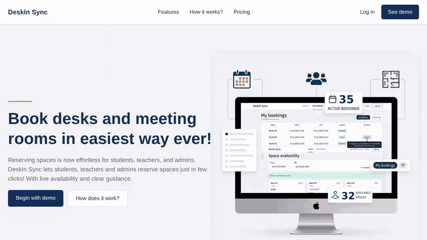
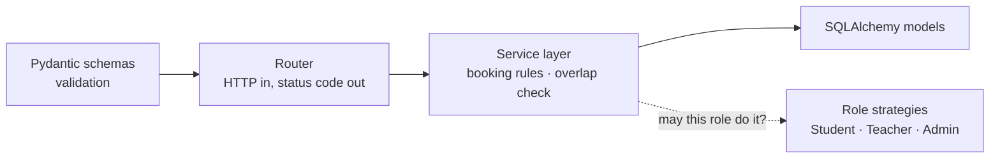
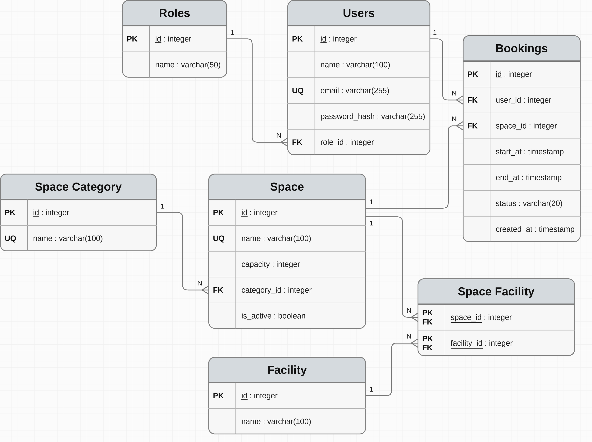
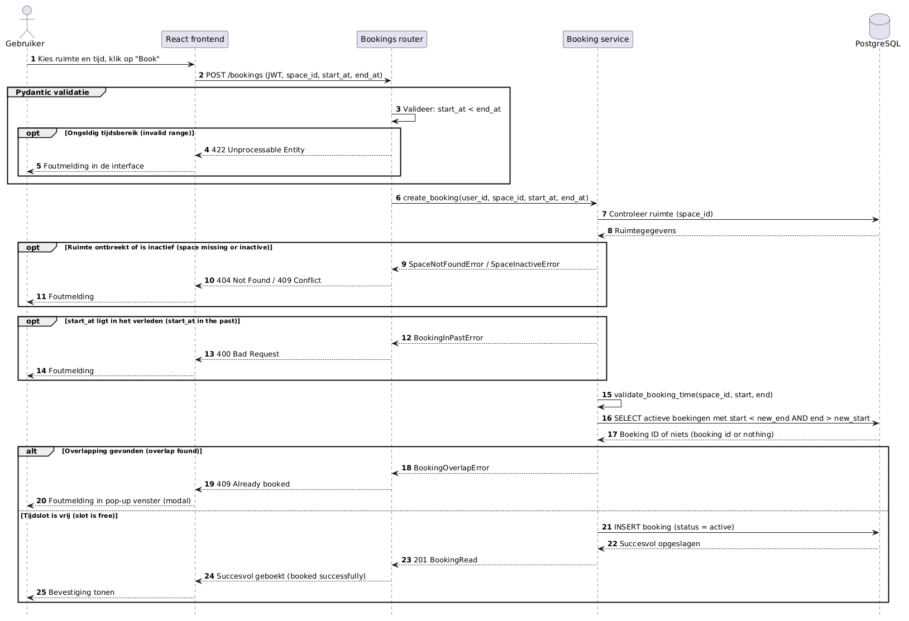
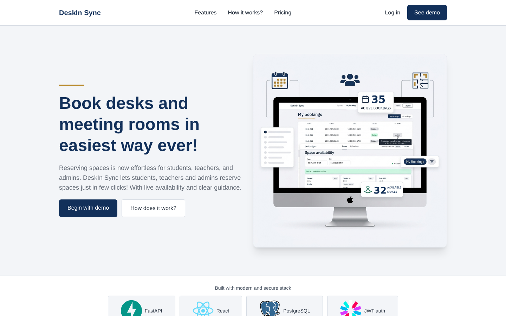
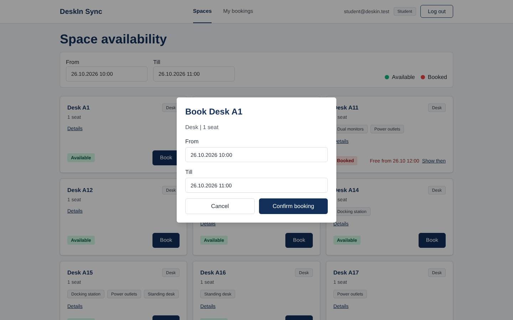
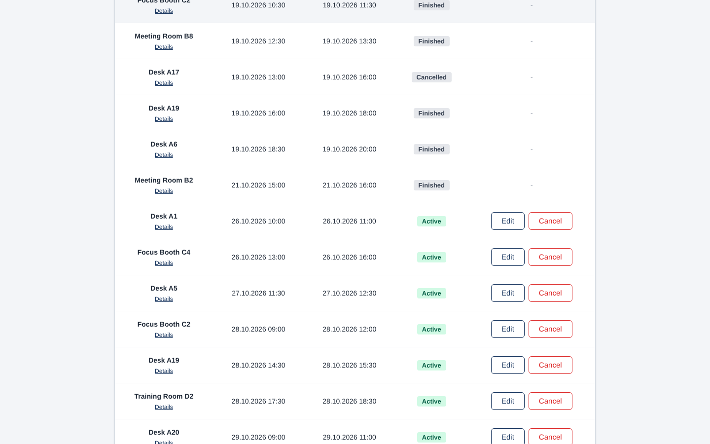
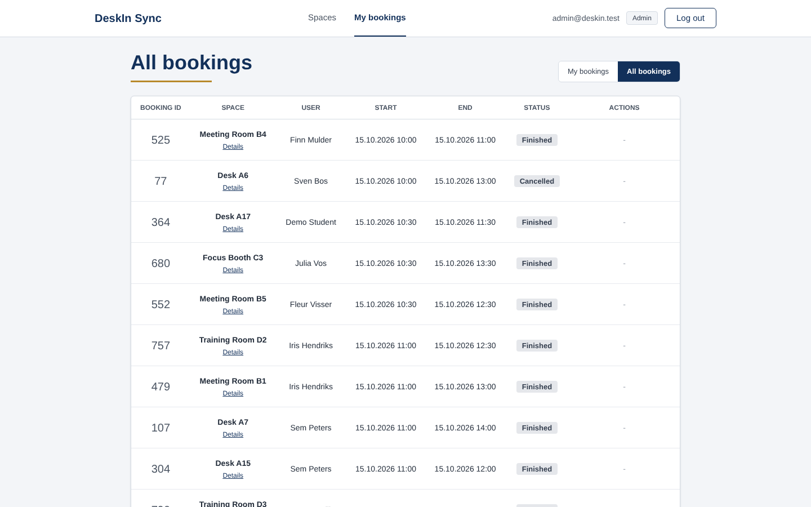

<div align="center">

# DeskIn Sync

**Book desks and rooms for any time window.**
A full-stack booking app for students, teachers and admins — live availability, overlap-free bookings and role-based rules.


[](https://github.com/purpledocx/deskin-sync/actions/workflows/ci.yml)


[Features](#key-features) · [Quick start](#quick-start) · [Architecture](#architecture) · [Testing & CI](#testing--ci) · [Design docs](#design-docs)

[Backend README](backend/README.md) · [Frontend README](frontend/README.md) · [Definition of Done](DoD.md)



</div>

---

## Overview

DeskIn Sync lets users find a free desk, focus booth, meeting room or training room for a chosen time window and book it in a few clicks. The repository contains two parts:

| Component | Stack | Description |
| --- | --- | --- |
| [`backend/`](backend/README.md) | FastAPI · Pydantic 2 · SQLAlchemy 2 · Alembic · PostgreSQL · JWT + bcrypt | REST API with authentication, availability search and booking rules |
| [`frontend/`](frontend/README.md) | React 19 · Vite 8 · React Router 7 · Tailwind CSS 4 · ESLint | Single-page app with landing page, sign in / sign up, dashboard and bookings overview |

## Key features

- **Live availability** — see which spaces are available or booked for any time range, and when a booked space becomes free.
- **Overlap-free bookings** — the API never allows two active bookings for the same space at the same time.
- **Edit and cancel** — reschedule or cancel bookings; cancelled bookings stay in the history.
- **Roles** — *Student*, *Teacher* and *Admin* with different viewing and editing rights; see [Booking rules](#booking-rules).
- **JWT authentication** — OAuth2 password flow with bcrypt-hashed passwords.
- **Service layer** — all booking rules live in one place and are testable without HTTP.
- **Tested** — 69 pytest tests for authentication, bookings, availability and role rules.
- **CI** — every push runs pytest against a real PostgreSQL and ESLint on the frontend.

## Booking rules

A booking runs from a chosen start time to a chosen end time, picked in steps of 30 minutes. There
is no separate "whole day" mode — a full day is simply a booking that spans it.

| Role | Sees | May change or cancel | Change window |
| --- | --- | --- | --- |
| Student | own bookings | own bookings | until 30 minutes before the start |
| Teacher | all bookings | own bookings | until 30 minutes before the start |
| Admin | all bookings | all bookings | until the booking starts |

These rules are evaluated by the API only. The frontend never re-implements them: every booking it
receives carries `can_modify` and, when a change is blocked, a `lock_hint` explaining why — that is
what the interface renders. Role permissions live in
[`backend/app/strategies/role_strategy.py`](backend/app/strategies/role_strategy.py) (Strategy
pattern), the change window in
[`backend/app/services/booking_service.py`](backend/app/services/booking_service.py).

### Known limitations

- **Overlap is enforced in the service layer, not by a database constraint.** Every create and
  update checks for conflicts (`existing.start_at < new.end_at AND existing.end_at > new.start_at`,
  over `active` bookings only) and rejects them with HTTP 409. The `bookings` table itself has no
  `EXCLUDE` constraint, so two requests arriving at the very same moment could in theory both pass
  the check. For the scope of this project that is an accepted trade-off; a PostgreSQL
  `EXCLUDE USING gist` constraint over `(space_id, tstzrange(start_at, end_at))` would be the fix
  if real concurrency mattered.
- There are no configurable opening hours and no maximum booking length: any time window in the
  future is accepted.

## Architecture


Inside the backend a request passes through these layers:



| Layer | Where | Responsibility |
| --- | --- | --- |
| Schemas | [`backend/app/schemas/`](backend/app/schemas) | Validate input and shape responses (Pydantic) |
| Routers | [`backend/app/routers/`](backend/app/routers) | HTTP only: call the service, map errors to status codes |
| Services | [`backend/app/services/`](backend/app/services) | Business rules: overlap check, create, update, cancel |
| Strategies | [`backend/app/strategies/`](backend/app/strategies) | Per-role permissions (Strategy pattern) |
| Models | [`backend/app/models/`](backend/app/models) | SQLAlchemy tables, migrated with Alembic |

## Repository structure

```text
deskin-sync/
├── backend/        # FastAPI app, Alembic migrations, seeder, pytest suite
├── frontend/       # React + Vite single-page app
├── docs/           # ERD, diagrams, wireframes, screenshots and showcase
├── .github/        # GitHub Actions workflow (pytest + ESLint)
├── DoD.md          # Definition of Done (Dutch)
└── README.md
```

## Quick start

**Prerequisites:** Python 3.14, PostgreSQL, Node.js 20.19+ / 22.13+ / 24+ and npm.

**1. Backend** — API on <http://127.0.0.1:8000>

```bash
cd backend
python -m venv .venv
source .venv/bin/activate          # Windows: .venv\Scripts\activate
pip install -r requirements.txt
cp .env.example .env               # set database URLs and a long random JWT_SECRET_KEY
alembic upgrade head
python seeder.py                   # optional demo data
uvicorn app.main:app --reload
```

**2. Frontend** — app on <http://localhost:5173>

```bash
cd frontend
npm ci
echo "VITE_API_URL=http://127.0.0.1:8000" > .env
npm run dev
```

With the seeder data you can log in as `student@deskin.test`, `teacher@deskin.test` or `admin@deskin.test` using the `DEMO_PASSWORD` from `backend/.env`.

Full setup, environment variables, API reference and scripts are in the [backend](backend/README.md) and [frontend](frontend/README.md) READMEs.

## API documentation

While the backend is running, FastAPI serves interactive docs at [`/docs`](http://127.0.0.1:8000/docs) (Swagger UI) and [`/redoc`](http://127.0.0.1:8000/redoc) (ReDoc).

## Testing & CI

| Check | Command | What it covers |
| --- | --- | --- |
| Backend tests | `cd backend && python -m pytest -q` | 69 tests: auth, booking API, booking service, role strategies, availability |
| Frontend lint | `cd frontend && npm run lint` | ESLint on all React code |
| Frontend build | `cd frontend && npm run build` | Production build with Vite |

The tests run against a separate database (`deskin_sync_test`) and refuse to start on any other one. The same checks run automatically on every push and pull request in [GitHub Actions](.github/workflows/ci.yml) and [GitLab CI](.gitlab-ci.yml), with a throwaway PostgreSQL service container.

## Design docs

| Document | File |
| --- | --- |
| Entity relationship diagram | [`docs/ERD.png`](docs/ERD.png) |
| Class diagram (schemas + role strategies) | [`docs/Klassendiagram.png`](docs/Klassendiagram.png) · [source](docs/Klassendiagram.puml) |
| Sequence diagram (overlap prevention) | [`docs/Sequence_diagram.png`](docs/Sequence_diagram.png) |
| Flowchart / sitemap | [`docs/Flowchart.png`](docs/Flowchart.png) |
| Wireframes | [`docs/wireframes/`](docs/wireframes) |

<details>
<summary>Show the ERD and the sequence diagram</summary>





</details>

## Screenshots

<table>
  <tr>
    <td width="50%" valign="top">
      <br>
      <sub><b>Landing page</b></sub>
    </td>
    <td width="50%" valign="top">
      <br>
      <sub><b>Booking a space</b></sub>
    </td>
  </tr>
  <tr>
    <td valign="top">
      <br>
      <sub><b>My bookings</b></sub>
    </td>
    <td valign="top">
      <br>
      <sub><b>All bookings (admin view)</b></sub>
    </td>
  </tr>
</table>

More screenshots: [frontend README](frontend/README.md#screenshots).

## Contributing

Work follows the [Definition of Done](DoD.md): clear acceptance criteria, backend validation, updated pytest tests that all pass, `npm run lint` without errors, a linked GitLab issue and a merge request.
