<div align="center">

# DeskIn Sync — Frontend

**React web app for finding and booking desks and rooms.**
Students, teachers and admins check live availability, book a space in a few clicks and manage their bookings.


[Backend README](../backend/README.md) · [Project root](../README.md) · [Definition of Done](../DoD.md)

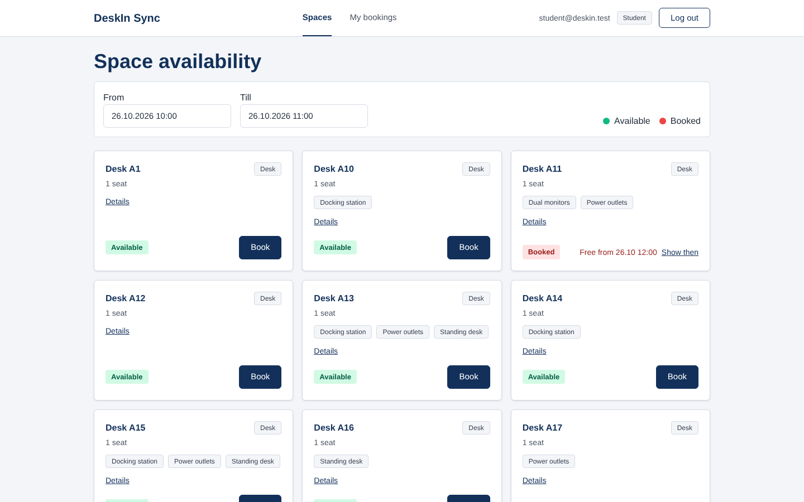

</div>

---

## Contents

- [Overview](#overview)
- [Key features](#key-features)
- [Tech stack](#tech-stack)
- [Project structure](#project-structure)
- [Pages and user flows](#pages-and-user-flows)
- [Prerequisites](#prerequisites)
- [Getting started](#getting-started)
- [Environment variables](#environment-variables)
- [Available scripts](#available-scripts)
- [Communication with the API](#communication-with-the-api)
- [Authentication](#authentication)
- [Screenshots](#screenshots)
- [Contributing](#contributing)
- [License](#license)

---

## Overview

The frontend is a single-page application built with React 19 and Vite. It talks to the [DeskIn Sync FastAPI backend](../backend/README.md) over HTTP/JSON and covers the complete booking journey:

1. a public marketing landing page,
2. sign up / log in,
3. a dashboard that shows which spaces are available for a chosen time window,
4. booking, rescheduling and cancelling, and
5. a bookings overview — with an "All bookings" view for teachers and admins.

## Key features

- **Live availability** — pick a time range (30-minute steps) and see every active space as *Available* or *Booked*, including when a booked space becomes free (with a **Show then** shortcut).
- **Space details** — category, capacity, facilities and the booked time slots for that day.
- **Book in a modal** — the selected time range is pre-filled; server errors (overlap, past time, inactive space) are shown inline.
- **My bookings** — status labels (*Active*, *Finished*, *Cancelled*), **Edit** and **Cancel** actions, and locked actions with a tooltip within 30 minutes of the start.
- **Role-aware UI** — teachers and admins can switch between *My bookings* and *All bookings* (with booking ID and user columns).
- **Client-side validation** on sign up that mirrors the backend rules, plus readable messages for FastAPI `422` validation errors.
- **Protected routes** — `/app/*` is only reachable with a valid, non-expired token.

## Tech stack

| Concern | Technology (from `package.json` / `package-lock.json`) |
| --- | --- |
| UI library | React 19 (`react`, `react-dom`) |
| Build tool / dev server | Vite 8 with `@vitejs/plugin-react` |
| Routing | React Router 7 (`react-router-dom`, `BrowserRouter`) |
| Styling | Tailwind CSS 4 via `@tailwindcss/vite`; design tokens (colors, radius, shadows) in `src/index.css` (`@theme`) |
| Date/time input | `react-datepicker` 9 |
| HTTP | Native `fetch`, wrapped in `src/api/client.js` |
| State | React component state (`useState` / `useEffect`); no global state library. The session is derived from the JWT in `localStorage`. |
| Linting / formatting | ESLint 10 (flat config with `eslint-plugin-react-hooks` and `eslint-plugin-react-refresh`), Prettier 3 |
| Package manager | npm (`package-lock.json`, lockfile v3) |
| Language | JavaScript (JSX) |

## Project structure

```text
frontend/
├── public/                     # static assets (marketing images, stack icons)
├── src/
│   ├── main.jsx                # React root + BrowserRouter
│   ├── App.jsx                 # route definitions
│   ├── index.css               # Tailwind import, @theme tokens, component classes
│   ├── api/
│   │   ├── client.js           # fetch wrapper, base URL, token storage, error formatting
│   │   ├── auth.js             # register / login / logout
│   │   ├── bookings.js         # list / create / update / cancel bookings
│   │   ├── spaces.js           # availability + per-space booked slots
│   │   ├── session.js          # decode JWT payload, role helpers
│   │   └── dates.js            # UTC parsing and date formatting helpers
│   ├── components/
│   │   ├── AppLayout.jsx       # header with navigation, user email, role chip, log out
│   │   ├── ProtectedRoute.jsx  # redirects to login without a valid token
│   │   ├── marketing/          # landing page sections (Navbar, Hero, Features, ...)
│   │   └── modals/             # Booking, EditBooking, ConfirmCancel, SpaceDetails
│   └── pages/
│       ├── HomePage.jsx        # public landing page
│       ├── AuthPage.jsx        # log in / sign up
│       ├── DashboardPage.jsx   # space availability
│       └── MyBookingsPage.jsx  # bookings overview
├── eslint.config.js
├── .prettierrc
├── vite.config.js
└── package.json
```

## Pages and user flows

| Route | Page | Access | What happens |
| --- | --- | --- | --- |
| `/` | `HomePage` | Public | Landing page: hero, tech stack, features, "How it works", pricing, call to action. |
| `/register` | `AuthPage` (sign up tab) | Public | Create an account (new users become *Student*), then you are logged in automatically. |
| `/register?mode=login` | `AuthPage` (log in tab) | Public | Log in with email and password. |
| `/app` | `DashboardPage` | Logged in | Choose *From* / *Till*, browse spaces, open **Details**, **Book** a free space. |
| `/app/bookings` | `MyBookingsPage` | Logged in | See your bookings; **Edit** or **Cancel** upcoming ones. Teachers and admins can switch to **All bookings**. |

**Typical flow:** sign up → land on `/app` → set a time range → **Book** → confirm in the modal → see the success message → open **My bookings** → reschedule or cancel.

Behaviour worth knowing:

- Times are picked in the browser's local time zone, sent to the API as UTC ISO strings (`toISOString()`), and shown again in local time as `dd.MM.yyyy HH:mm`.
- Booking is disabled when the selected start time is in the past.
- In *My bookings*, Edit/Cancel are disabled within 30 minutes of the start for every role (the backend lets admins change bookings at any time).
- Cancelled bookings stay in the list with the *Cancelled* status.

## Prerequisites

- **Node.js** 20.19+, 22.13+ or 24+ — the range that satisfies every `engines` field in the dependencies (Vite 8 needs `^20.19.0 || >=22.12.0`, ESLint 10 needs `^20.19.0 || ^22.13.0 || >=24`).
- **npm** (bundled with Node.js).
- A running **[backend API](../backend/README.md)** on port 8000 with a migrated (and preferably seeded) database.

## Getting started

```bash
cd frontend
npm ci                       # or: npm install
```

Create `frontend/.env` (see [Environment variables](#environment-variables)):

```dotenv
VITE_API_URL=http://127.0.0.1:8000
```

Start the dev server:

```bash
npm run dev
```

Open <http://localhost:5173>. If you ran the backend seeder, you can log in with `student@deskin.test`, `teacher@deskin.test` or `admin@deskin.test` and the `DEMO_PASSWORD` from `backend/.env`.

> [!IMPORTANT]
> The backend's CORS settings only allow `http://localhost:5173` and `http://127.0.0.1:5173`. Keep the dev server on port 5173 (Vite's default), or add your origin to `allow_origins` in `backend/app/main.py`.

## Environment variables

| Variable | Required | Default | Description |
| --- | --- | --- | --- |
| `VITE_API_URL` | No | `http://localhost:8000` | Base URL of the FastAPI backend, read in `src/api/client.js` via `import.meta.env`. |

Vite inlines `VITE_*` variables at **build time**, so rebuild after changing them. `frontend/.env` is git-ignored.

### `.env.example`

```dotenv
# Base URL of the DeskIn Sync FastAPI backend
VITE_API_URL=http://127.0.0.1:8000
```

## Available scripts

All scripts are defined in `package.json` and run from `frontend/`.

| Command | Description |
| --- | --- |
| `npm run dev` | Start the Vite dev server with hot module replacement (port 5173). |
| `npm run build` | Create a production build in `dist/`. |
| `npm run preview` | Serve the production build locally. Vite uses port 4173 by default, which the backend CORS settings do not allow — use `npm run preview -- --port 5173` to test against the local API. |
| `npm run lint` | Run ESLint on the project (`dist/` is ignored). Required to pass by the [Definition of Done](../DoD.md). |
| `npm run format` | Format all files with Prettier (single quotes, semicolons, 2-space indentation). |

There is no frontend test runner configured.

## Communication with the API

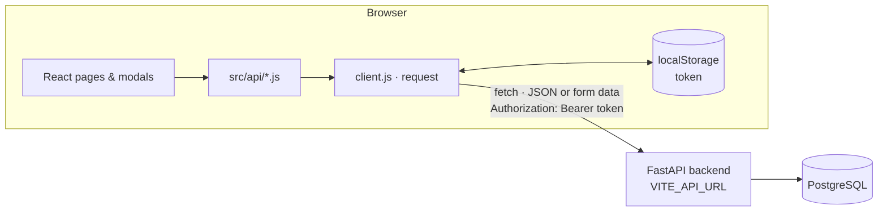

All requests go through `request()` in `src/api/client.js`, which:

- prefixes the path with `VITE_API_URL`,
- adds `Authorization: Bearer <token>` when a token is stored,
- sends JSON bodies (or URL-encoded form data for login),
- throws an `Error` with the HTTP `status` and a readable message (FastAPI `detail` strings and `422` validation lists are formatted for display; network failures get status `0` and "Server is unreachable").

| Module | Function | Endpoint |
| --- | --- | --- |
| `auth.js` | `register()` | `POST /auth/register` (JSON) |
| `auth.js` | `login()` | `POST /auth/login` (form: `username` = email, `password`) |
| `spaces.js` | `getAvailability()` | `GET /spaces/availability?start_at&end_at` |
| `spaces.js` | `getSpaceBookings()` | `GET /spaces/{id}/bookings?start_at&end_at` |
| `bookings.js` | `getBookings()` | `GET /bookings/` |
| `bookings.js` | `createBooking()` | `POST /bookings/` |
| `bookings.js` | `updateBooking()` | `PUT /bookings/{id}` |
| `bookings.js` | `cancelBooking()` | `DELETE /bookings/{id}` |

The trailing slash on `/bookings/` is intentional: without it FastAPI answers with a redirect.

## Authentication

Verified in `src/api/auth.js`, `src/api/client.js`, `src/api/session.js` and `src/components/ProtectedRoute.jsx`:

| Topic | Behaviour |
| --- | --- |
| Login | `login(email, password)` posts form data to `/auth/login` and stores `access_token`. |
| Sign up | `register()` creates the account, then `login()` is called automatically and the user is sent to `/app`. |
| Storage | The JWT is kept in `localStorage` under the key `token`. |
| Sending the token | Every request includes `Authorization: Bearer <token>`. |
| Route protection | `ProtectedRoute` decodes the JWT payload (`sub`, `user_id`, `role`, `exp`) in the browser and redirects to `/register?mode=login` if there is no token, it cannot be decoded, or `exp` has passed. The signature is verified by the backend, not the browser. |
| Session expiry | If the API returns `401` for a non-`/auth` request, the token is removed and the browser is redirected to the login page. |
| Refresh strategy | None. The backend issues no refresh token, so the user logs in again after the access token expires (60 minutes by default). |
| Log out | **Log out** removes the token from `localStorage` (client-side only; the backend has no logout endpoint). |
| Roles in the UI | The `role` claim drives the role chip in the header and the *All bookings* toggle (Teacher / Admin). The backend still enforces all permissions. |

## Screenshots

Captured from a local run against the backend with the seeder's demo data.

<table>
  <tr>
    <td width="50%" valign="top">
      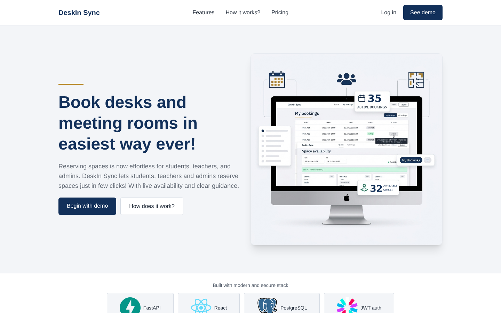<br>
      <sub><b>Landing page</b> — public marketing page at <code>/</code>.</sub>
    </td>
    <td width="50%" valign="top">
      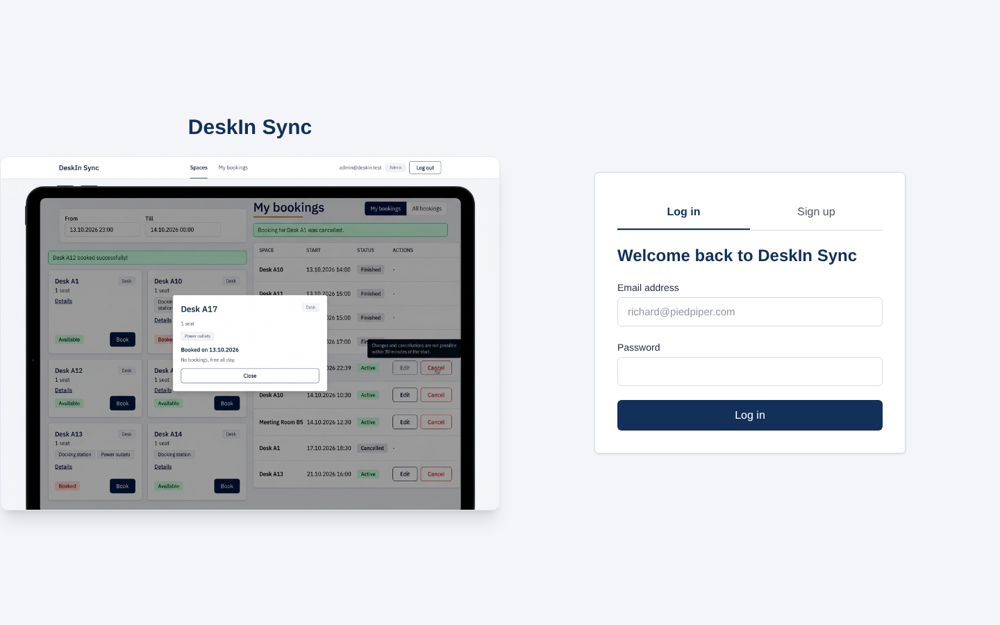<br>
      <sub><b>Log in</b> — <code>/register?mode=login</code>.</sub>
    </td>
  </tr>
  <tr>
    <td valign="top">
      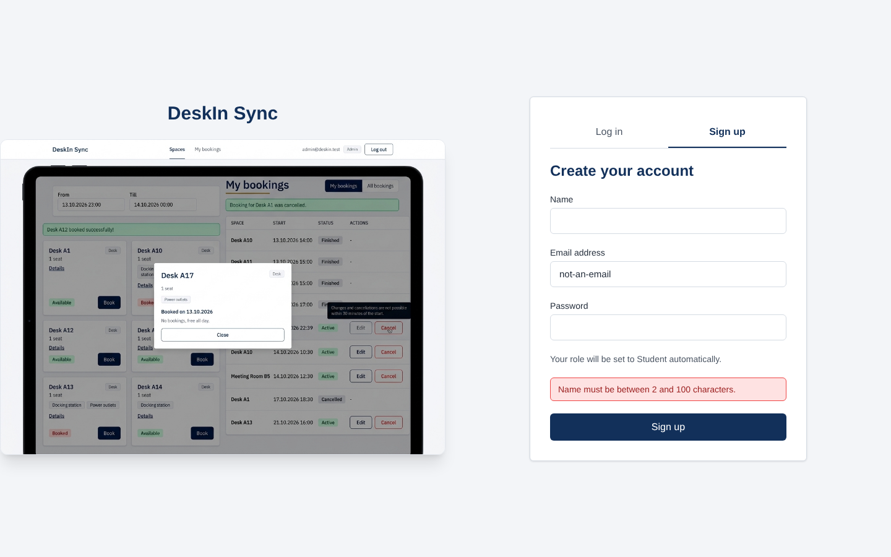<br>
      <sub><b>Sign up</b> — client-side validation before the request is sent.</sub>
    </td>
    <td valign="top">
      <br>
      <sub><b>Space availability</b> — available and booked spaces for the chosen window.</sub>
    </td>
  </tr>
  <tr>
    <td valign="top">
      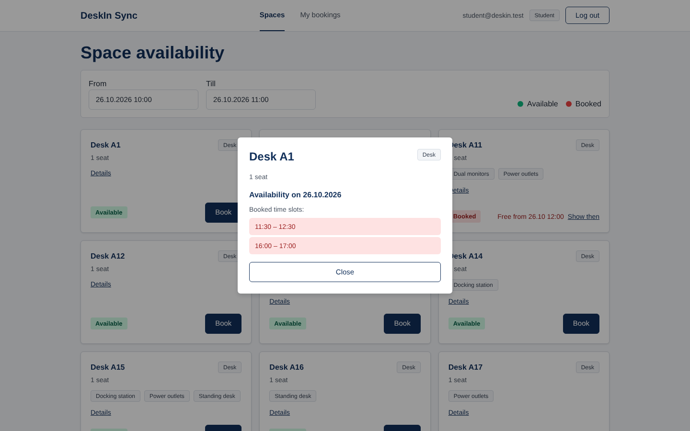<br>
      <sub><b>Space details</b> — booked time slots of the day.</sub>
    </td>
    <td valign="top">
      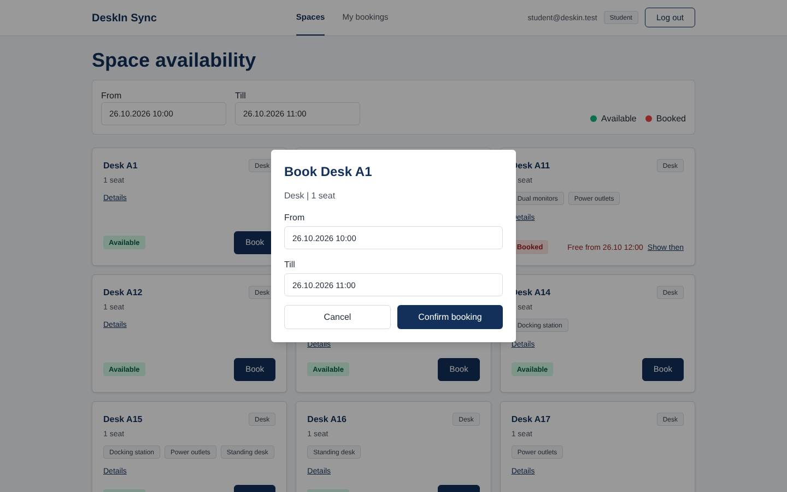<br>
      <sub><b>Book a space</b> — time range pre-filled from the dashboard.</sub>
    </td>
  </tr>
  <tr>
    <td valign="top">
      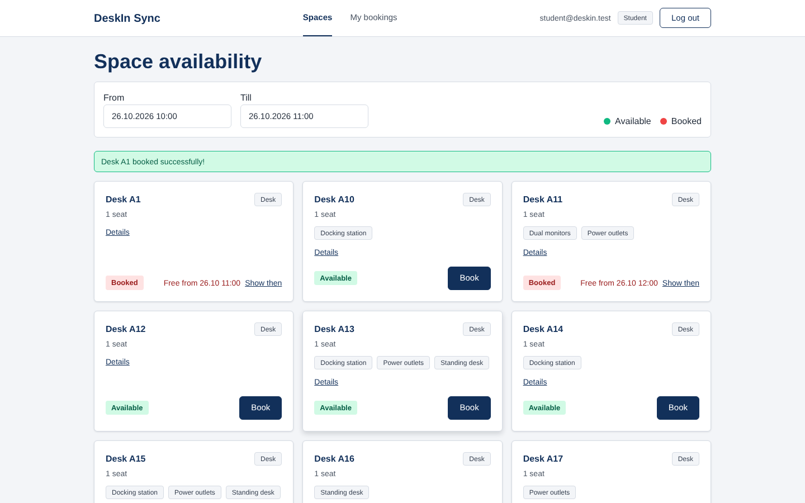<br>
      <sub><b>Booking confirmed</b> — the space now shows as booked.</sub>
    </td>
    <td valign="top">
      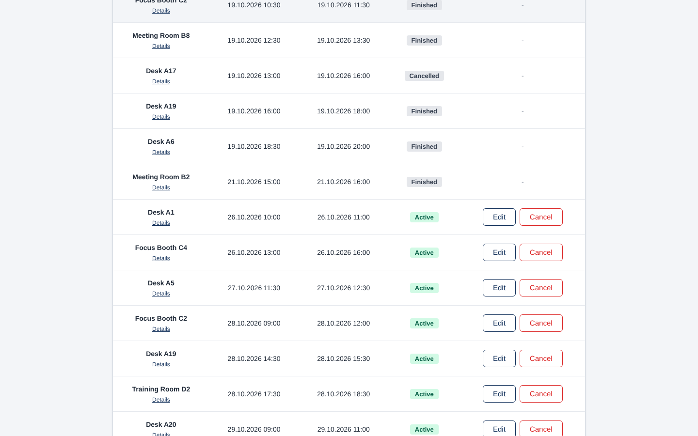<br>
      <sub><b>My bookings</b> — finished, cancelled and active bookings with actions.</sub>
    </td>
  </tr>
  <tr>
    <td valign="top">
      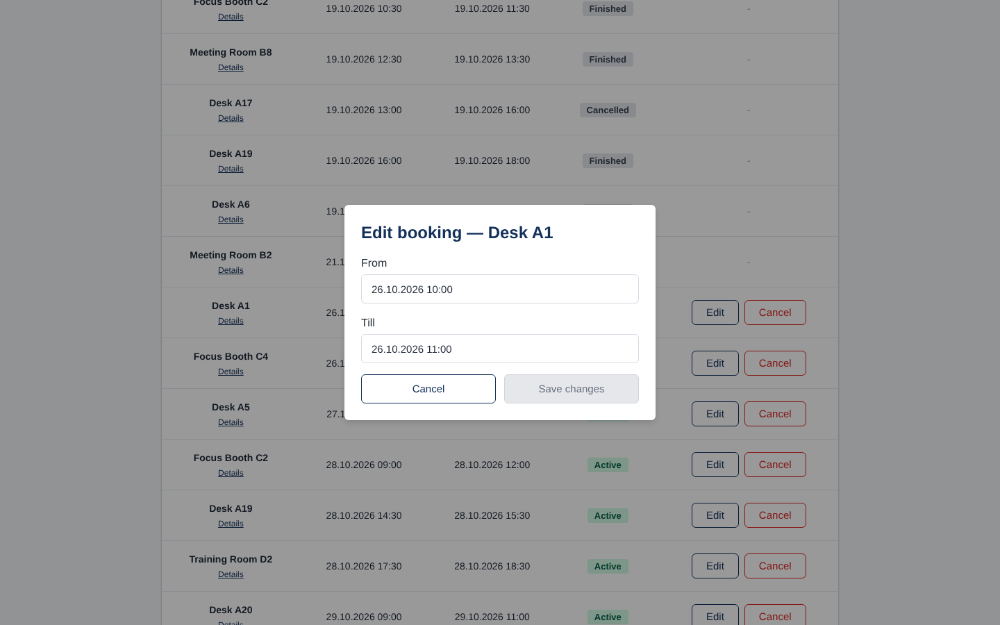<br>
      <sub><b>Edit booking</b> — reschedule an upcoming booking.</sub>
    </td>
    <td valign="top">
      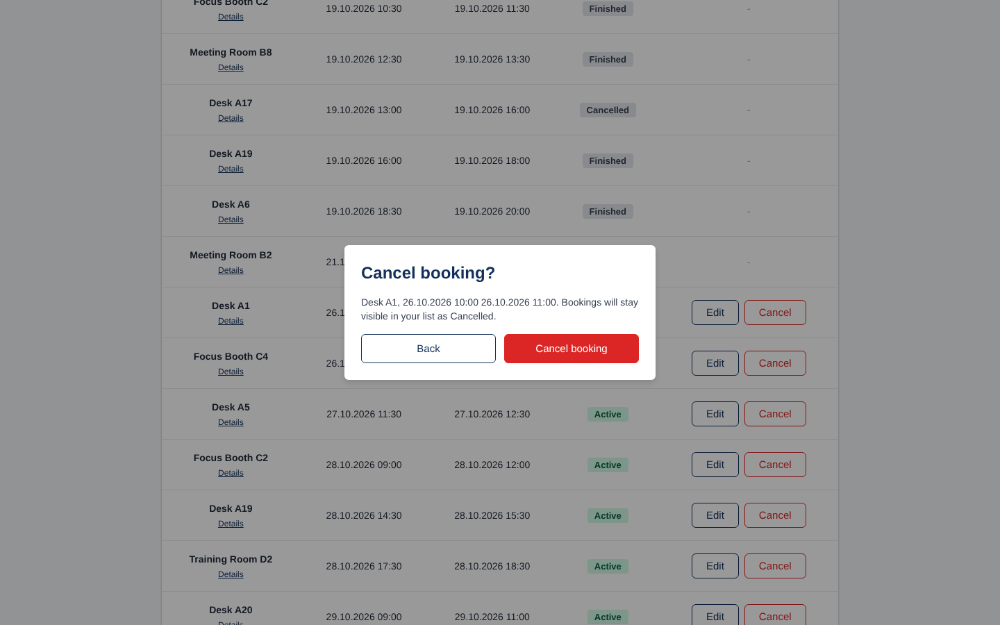<br>
      <sub><b>Cancel booking</b> — confirmation before the soft cancel.</sub>
    </td>
  </tr>
  <tr>
    <td colspan="2" valign="top">
      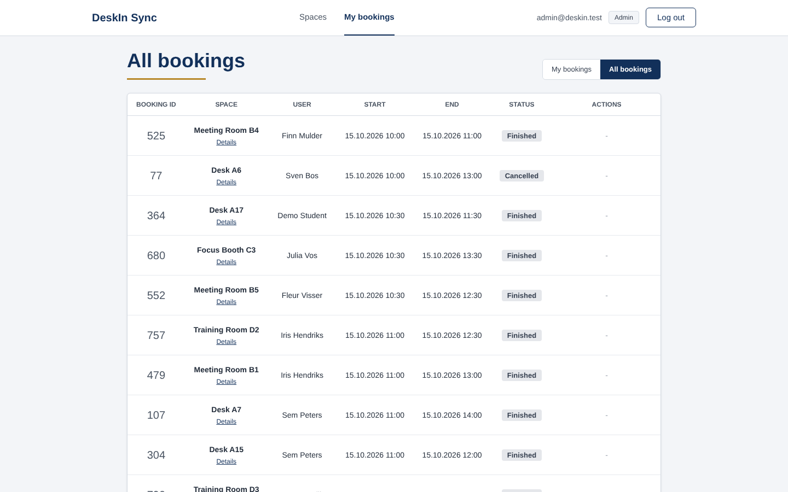<br>
      <sub><b>All bookings</b> — the admin/teacher view with booking ID and user columns.</sub>
    </td>
  </tr>
</table>

## Contributing

The repository includes a [Definition of Done](../DoD.md) (in Dutch). For frontend work this means in particular:

- the React interface (and FastAPI endpoint, if needed) is implemented for the task,
- errors are shown clearly to the user,
- `npm run lint` runs without errors,
- the change is linked to a GitLab issue, committed with a clear message and merged through a merge request, with evidence (screenshot, test log or MR link) saved.

Run `npm run format` before committing to keep the Prettier style consistent.

---

<div align="center">

[Backend README](../backend/README.md) · [Project root](../README.md)

</div>
